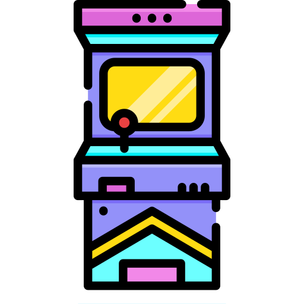

# Neon Arcade 🕹️

A collection of 36 classic arcade-style browser games built with HTML, CSS, and JavaScript. Each game features a sleek neon aesthetic and can be played directly in your web browser.



## 🎮 Available Games

### Classic Games
| Game | Description |
|------|-------------|
| 🐍 **Snake** | Classic snake game - eat food, grow longer, avoid walls |
| 🐦 **Flappy Bird** | Fly through pipes without hitting them |
| 🧱 **Breakout** | Bounce the ball and break all the bricks |
| 🏓 **Pong** | The original arcade paddle duel vs CPU (2P mode too) |
| ☄️ **Asteroids** | Thrust, shoot, and smash the floating rocks |
| 🐸 **Frogger** | Hop across traffic and ride logs over the river |
| 🏃 **Barrel Run** | Climb girders, leap the rolling barrels! |
| ⛏️ **Dig Dug** | Tunnel through dirt and inflate the monsters! |
| 🐛 **Centipede** | Split the serpent in the mushroom field! |
| 👽 **Q\*BERT** | Hop cubes and paint the pyramid gold! |
| 💣 **Bomberman** | Blast crates, clear monsters, find the exit! |
| 🎱 **JezzBall** | Seal the bouncing balls into shrinking zones! |

### Puzzle & Memory
| Game | Description |
|------|-------------|
| 🧠 **Memory** | Match pairs of cards to clear the board |
| 🎨 **Color Match** | Remember and match colors in sequence |
| ❌ **Tic-Tac-Toe** | Classic X and O strategy game |
| 🌀 **Maze Escape** | Find your way through the maze! |
| 🔷 **Tetris** | Stack the blocks and clear the lines! |
| 🧮 **2048** | Slide and merge tiles all the way to 2048 |
| 💣 **Minesweeper** | Clear the field without hitting any mines |

### Action & Reflex
| Game | Description |
|------|-------------|
| 🎈 **Balloon Pop** | Pop balloons before they float away! |
| ⚡ **Reaction** | Test your reflexes - click when green! |
| 🎯 **Shooting Gallery** | Sharpen your aim with precision! |
| 🏃 **Endless Runner** | Run forever, jump over obstacles |
| 🐹 **Whack-A-Mole** | Click the moles before they hide! |
| 👆 **Tap the Dot** | Tap the moving dot as fast as you can! |
| 🚀 **Space Dodger** | Dodge asteroids in space! |
| 👾 **Space Invaders** | Hold the line against the alien swarm! |
| 🛸 **Galaga** | Shoot down the diving bug fleet! |
| 🟡 **Maze Chase** | Eat every dot and outsmart the ghosts! |
| 💥 **Missile Command** | Defend your cities from incoming warheads! |

### Chance & Luck
| Game | Description |
|------|-------------|
| 👆 **Clicker** | Click as fast as you can! |
| 🎲 **Dice & Coin** | Roll the dice or flip the coin! |
| 🧺 **Catcher** | Catch falling objects! |

### Skill Challenge
| Game | Description |
|------|-------------|
| ⌨️ **Typing Speed** | Type words fast to test your WPM! |
| 🔢 **Number Guess** | Guess the secret number - get hints! |
| ➕ **Math Challenge** | Solve math problems lightning fast! |

## 🚀 How to Play

1. Clone or download this repository
2. Open `index.html` in any modern web browser
3. Select a game from the arcade menu
4. Use keyboard, mouse, or touch to play!

No installation required - just open in your browser!

## 📁 Project Structure

```
├── index.html          # Main arcade hub
├── records.html        # Hall of Fame - all your high scores
├── arcade.js           # Shared engine: 8-bit SFX, CRT, mute, D-pad, pause
├── style.css           # Global styles (neon theme)
├── logo.png            # Site logo
├── snake/              # Snake game
├── flappy/            # Flappy Bird clone
├── breakout/          # Breakout game
├── pong/              # Pong (1P vs CPU / 2P)
├── asteroids/         # Asteroids
├── frogger/           # Frogger
├── barrelrun/         # Barrel Run (ladder dodger)
├── digdug/            # Dig Dug (tunnel digger)
├── centipede/         # Centipede (mushroom shooter)
├── qbert/             # Q*bert (iso cube hopper)
├── bomberman/         # Bomberman (bomb maze)
├── jezzball/          # JezzBall (line sealer)
├── blockdrop/         # Tetris
├── game2048/          # 2048
├── minesweeper/       # Minesweeper
├── spaceinvaders/     # Space Invaders
├── galaga/            # Galaga
├── pacman/            # Maze Chase (Pac-Man style)
├── missilecommand/    # Missile Command
├── memory/            # Memory matching game
├── colormatch/        # Color match game
├── tictactoe/        # Tic-Tac-Toe game
├── mazeescape/        # Maze escape game
├── balloonpop/       # Balloon pop game
├── reaction/          # Reaction time game
├── shootinggallery/   # Shooting gallery game
├── endlessrunner/     # Endless runner game
├── whackamole/       # Whack-A-Mole game
├── tapthedot/        # Tap the dot game
├── spacedodger/      # Space dodger game
├── clicker/          # Clicker game
├── diceflip/         # Dice & coin game
├── catcher/          # Catcher game
├── typingspeed/      # Typing speed game
├── numberguess/      # Number guess game
└── mathchallenge/   # Math challenge game
```

## 🎨 Features

- ✨ Neon visual theme throughout all games
- 🔊 Retro 8-bit sound effects in every game (shared `arcade.js` engine)
- 📺 Optional CRT scanline & flicker overlay (toggle in-game)
- 🔇 Global mute button - settings persist across games
- ⏸️ Press **P** to pause in-game
- 📱 Touch D-pad controls appear automatically on mobile devices
- 🏆 Hall of Fame (`records.html`) aggregates all high scores in one place
- 📱 Responsive design works on desktop and mobile
- 🎯 Intuitive controls for each type of game
- 💾 Local storage for high scores
- 🚀 Smooth animations and transitions

## 🔧 Technologies Used

- HTML5 for game structure
- Pure JavaScript (no frameworks)
- CSS3 animations and transitions

## 🤝 Contributing

Feel free to fork this project, add new games, improve existing ones, or fix bugs!

## 📝 License

MIT License - feel free to use this project for learning or personal projects!

---

Made with ❤️ using pure HTML, CSS & JavaScript
